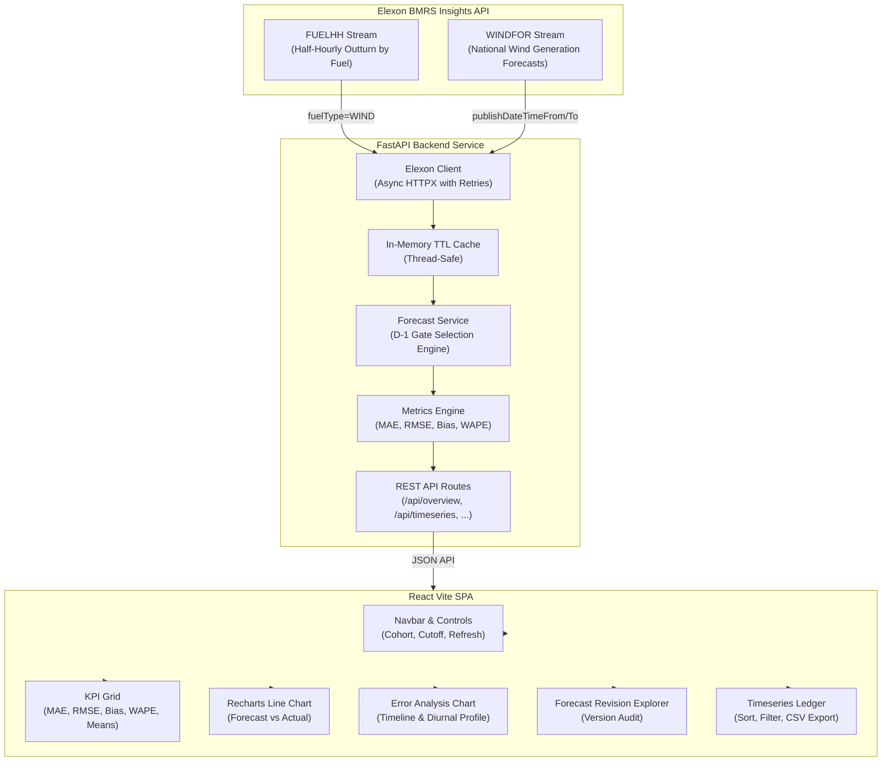

# Wind Intelligence — UK Wind Forecast Accuracy Dashboard

> **Production-grade energy analytics platform evaluating Great Britain Day-Ahead wind generation forecast accuracy against actual outturns using official Elexon BMRS datasets for the January 2026 decision cohort.**

[](https://github.com/SachinThakur1124/Wind-Intelligence-assessment)
[](backend/tests)
[](frontend/src/tests)
[](https://www.python.org/)
[](https://fastapi.tiangolo.com/)
[](https://react.dev/)

### Project Links & Submission Assets
- **GitHub Repository**: [https://github.com/SachinThakur1124/Wind-Intelligence-assessment](https://github.com/SachinThakur1124/Wind-Intelligence-assessment)
- **Live Backend API (Render - Verified)**: [https://wind-intelligence-assessment.onrender.com](https://wind-intelligence-assessment.onrender.com)
- **Backend API Health Check**: [https://wind-intelligence-assessment.onrender.com/api/health](https://wind-intelligence-assessment.onrender.com/api/health)
- **Interactive Swagger / OpenAPI Docs**: [https://wind-intelligence-assessment.onrender.com/docs](https://wind-intelligence-assessment.onrender.com/docs)
- **Live Deployed Frontend (Vercel)**: [https://wind-intelligence-assessment.vercel.app](https://wind-intelligence-assessment.vercel.app) *(or your deployed Vercel domain)*
- **10-Minute Video Demo (YouTube)**: *[Record and link following DEMO_SCRIPT.md]*

---

## 1. Executive Summary & Business Context

UK electricity utilities procure power in the Day-Ahead wholesale market (EPEX SPOT and Nord Pool / N2EX) to balance forecast consumer demand against expected renewable generation. Because wind generation is intermittent, trading desks must estimate national wind delivery volume and quantify forecast uncertainty **before wholesale auction gate closure**.

Overprocuring electricity leads to surplus power sold back at discount imbalance prices; underprocuring risks exposure to costly system buy prices during scarcity periods. 

### Core Questions Answered
1. **What wind generation forecast was available when the day-ahead purchase decision needed to be made?**
2. **How accurate was that forecast compared with actual national wind generation outturns?**

---

## 2. Key Product Features

- **Decision-Gate Cutoff Engine**: Reconstructs the exact forecast state available at the day-ahead auction gate closure (default **11:00 UTC on D-1**, configurable to **09:50 UTC** for GB auction gate or **12:00 UTC**). Discards all post-cutoff revisions.
- **Statistical Metric Suite**: Calculates **MAE**, **RMSE**, **Bias**, and **WAPE** on matched half-hourly pairs, with explicit sign conventions (+Bias = overforecasting).
- **Time-Series Visualization**: High-performance interactive Recharts line chart supporting date windowing (weekly / full 31-day cohort) with single-interval inspection.
- **Error & Uncertainty Analysis**: Visualizes signed errors ($F - A$) over time and breaks down forecast error profiles across the 24 hours of the delivery day.
- **Forecast Revision Explorer**: Deep-dives into individual delivery dates to inspect all historical publications, highlighting the exact version eligible at gate closure vs. superseded or disqualified intraday revisions.
- **Auditable Timeseries Ledger**: Searchable, sortable, paginated half-hourly table with instant **CSV export** for trading desk workflows.
- **Data Quality & Governance Panel**: Transparent reporting of missing intervals, duplicate resolution, API coverage percentages (100% in Jan 2026), and wholesale procurement disclaimers.

---

## 3. Architecture & Data Flow



---

## 4. Technology Stack

| Layer | Technologies | Justification |
| :--- | :--- | :--- |
| **Backend** | Python 3.12, FastAPI, Pydantic v2, Pandas, NumPy, HTTPX | High-throughput asynchronous API, strict schema validation, vector math for error metrics. |
| **Frontend** | React 18, Vite, TypeScript, Tailwind CSS, Recharts, Lucide Icons | Responsive trading dashboard, strongly typed contracts, interactive SVG charting. |
| **Testing** | Pytest, Pytest-Asyncio, Vitest, React Testing Library | Deterministic unit tests with synthetic fixtures for both backend and UI layers. |
| **Infrastructure** | Docker, Docker Compose, Multi-stage Nginx container | Standardized containerization for reproducible local runs and production deployment. |

---

## 5. Source Datasets & API Discovery Note

Analytical inputs are restricted exclusively to official Elexon BMRS streams:

| Dataset | Official Documentation Link | Update Frequency | Granularity | Field Used |
| :--- | :--- | :--- | :--- | :--- |
| **Actual Generation** | [`/datasets/FUELHH/stream`](https://bmrs.elexon.co.uk/api-documentation/endpoint/datasets/FUELHH/stream) | Half-hourly outturn | 30 min (Settlement Periods 1–48) | `generation` (MW), filtered to `fuelType = 'WIND'` |
| **Forecast Generation** | [`/datasets/WINDFOR/stream`](https://bmrs.elexon.co.uk/api-documentation/endpoint/datasets/WINDFOR/stream) | Multi-daily (~every 3–4 hrs) | Hourly intervals (`HH:00:00Z`) | `generation` (MW), `publishTime`, `startTime` |

### Research Findings & Known API Behaviors:
1. **Filtering Parameters**:
   - `FUELHH/stream` accepts `settlementDateFrom`, `settlementDateTo`, and `fuelType=WIND`.
   - `WINDFOR/stream` accepts `publishDateTimeFrom` and `publishDateTimeTo` (ISO UTC). Omitting these parameters defaults to the latest published forecast snapshot.
2. **Units & Scale**:
   - Both datasets report in **Megawatts (MW)**. All values throughout the dashboard, metrics, tooltips, and exports remain strictly in MW for consistency.
3. **Timezones**:
   - All timestamps in both streams are ISO 8601 UTC (`Z`). Handled internally with timezone-aware `datetime` objects.
4. **Temporal Granularity Mapping**:
   - `WINDFOR` forecasts are published at hourly intervals (`HH:00:00Z`). In power systems and Great Britain wholesale trading, an hourly forecast of MW represents expected average generation capacity for the full clock hour. Therefore, Settlement Period $2k-1$ (`HH:00`) and Settlement Period $2k$ (`HH:30`) inherit the hourly forecast generation rate.
5. **January 2026 Scope & Data Completeness**:
   - January 2026 purchase decisions evaluate delivery intervals from **2026-01-02 00:00:00Z to 2026-02-01 23:30:00Z** (31 delivery days = 1,488 half-hours).
   - Live Elexon API retrieval verified **100% coverage** (1,488/1,488 matched half-hourly periods).

---

## 6. Day-Ahead Decision Methodology (Phase 2)

### Rationale
In the Great Britain wholesale market, utilities purchase electricity on day $D-1$ for delivery on day $D$:
- EPEX SPOT and Nord Pool / N2EX day-ahead auctions close at **09:50 UK local time (GMT)**.
- National Grid ESO / Elexon operational planning horizons and bilateral day-ahead notifications operate around **11:00 UTC** and **12:00 UTC**.

### Selection Rules
For each delivery interval on target delivery date $D$:
1. **Purchase Decision Date**: Defined as calendar day $D - 1$.
2. **Decision Cutoff Timestamp**: Set to $(D - 1) \text{ at } \text{Cutoff Time}$ (default **11:00:00 UTC**, configurable to **09:50 UTC** or **12:00 UTC**).
3. **Eligible Forecast Pool**: A forecast record is eligible if and only if $\text{publishTime} \le \text{Cutoff Timestamp}$.
4. **Selected Version**: Among all eligible candidate publications for the target interval, the system deterministically selects the **latest valid publication**: $\max(\text{publishTime})$.
5. **Disqualification of Later Data**: Forecasts published *after* the cutoff timestamp (e.g. intraday runs or afternoon revisions) are disqualified for day-ahead accuracy analysis, even if they are closer to real time and more accurate.

---

## 7. Statistical Metric Definitions (Phase 4)

Calculated on matched valid forecast/actual pairs $(F_i, A_i)$ where $N$ is the number of matched half-hour periods:

$$\text{Error}_i = F_i - A_i$$

- **MAE (Mean Absolute Error)**: Measures average magnitude of volume error:
  $$\text{MAE} = \frac{1}{N} \sum_{i=1}^N |F_i - A_i|$$
- **RMSE (Root Mean Squared Error)**: Penalizes large misses that cause severe balancing issues:
  $$\text{RMSE} = \sqrt{\frac{1}{N} \sum_{i=1}^N (F_i - A_i)^2}$$
- **Forecast Bias (Mean Error)**:
  $$\text{Bias} = \frac{1}{N} \sum_{i=1}^N (F_i - A_i)$$
  > **Sign Convention**: **Positive bias ($> 0$) denotes systematic overforecasting** (forecast was higher than actual generation). Negative bias ($< 0$) denotes systematic underforecasting.
- **WAPE (Weighted Absolute Percentage Error)**:
  $$\text{WAPE} = \frac{\sum_{i=1}^N |F_i - A_i|}{\sum_{i=1}^N A_i} \times 100\%$$
  > **Mathematical Guard**: WAPE is calculated only when $\sum A_i > 0$. If actual generation is zero, WAPE is flagged as unavailable (`null`) to avoid division by zero.

### January 2026 Observed Baseline (Live Elexon Data, 11:00 UTC Cutoff)
- **Matched Observations**: 1,488 / 1,488 (100.0% coverage)
- **MAE**: 2,016.31 MW
- **RMSE**: 2,510.25 MW
- **Forecast Bias**: +1,729.93 MW *(Systematic overforecasting)*
- **WAPE**: 17.87%
- **Forecast Mean**: 13,013.49 MW
- **Actual Mean**: 11,283.56 MW

---

## 8. Repository Folder Structure

```
.
├── backend/
│   ├── app/
│   │   ├── api/
│   │   │   └── routes.py              # REST API endpoints
│   │   ├── core/
│   │   │   ├── cache.py               # Thread-safe in-memory TTL cache
│   │   │   └── config.py              # Configuration & CORS settings
│   │   ├── schemas/
│   │   │   └── responses.py           # Pydantic v2 data models
│   │   ├── services/
│   │   │   ├── elexon_client.py       # Async HTTP client with backoff
│   │   │   ├── forecast_service.py    # Cutoff engine & matching logic
│   │   │   └── metrics_service.py     # Statistical calculations
│   │   └── main.py                    # FastAPI application entry point
│   ├── tests/
│   │   ├── test_api_routes.py         # Route integration tests
│   │   ├── test_forecast_service.py   # Decision cutoff unit tests
│   │   └── test_metrics_service.py    # Metric mathematical unit tests
│   ├── Dockerfile                     # Python 3.12 slim Docker image
│   ├── pytest.ini                     # Pytest configuration
│   └── requirements.txt               # Backend dependencies
├── frontend/
│   ├── src/
│   │   ├── components/
│   │   │   ├── common/                # Navbar, KpiCard, States
│   │   │   └── features/              # Charts, Table, Explorer, Quality Panel
│   │   ├── hooks/
│   │   │   └── useDashboardData.ts    # Dashboard data & refresh state
│   │   ├── lib/
│   │   │   ├── api.ts                 # Typed fetch client
│   │   │   └── formatters.ts          # Number & date formatting utilities
│   │   ├── tests/
│   │   │   ├── formatters.test.ts     # Formatting unit tests
│   │   │   ├── KpiCard.test.tsx       # KPI card component tests
│   │   │   └── States.test.tsx        # Loading & Error state tests
│   │   ├── types/
│   │   │   └── api.ts                 # TypeScript response interfaces
│   │   ├── App.tsx                    # Main Dashboard SPA layout
│   │   ├── main.tsx                   # React root entry
│   │   └── index.css                  # Tailwind styles
│   ├── Dockerfile                     # Multi-stage Nginx production build
│   ├── nginx.conf                     # SPA routing & API reverse proxy
│   ├── package.json                   # Frontend dependencies
│   ├── tsconfig.json                  # TypeScript compiler settings
│   └── vite.config.ts                 # Vite & Vitest configuration
├── docker-compose.yml                 # Local multi-container orchestration
├── render.yaml                        # Automated Render cloud deployment blueprint
├── .env.example                       # Environment template
└── README.md                          # Full system documentation
```

---

## 9. Local Setup & Execution

### Prerequisites
- **Python 3.12+**
- **Node.js 20+** and **npm**
- *(Optional)* **Docker & Docker Compose**

### Option A: Running with Docker Compose (Recommended)

```bash
# Clone the repository
git clone <repo-url>
cd <repo-folder>

# Build and start all services
docker compose up --build
```
- Frontend will be available at: **http://localhost:3000**
- Backend API will be available at: **http://localhost:8000**
- API Documentation (Swagger UI): **http://localhost:8000/docs**

---

### Option B: Running Locally without Docker

#### 1. Backend Setup
```bash
cd backend

# Create and activate virtual environment
python -m venv venv
# On Windows:
.\venv\Scripts\activate
# On Linux/macOS:
source venv/bin/activate

# Install dependencies
pip install -r requirements.txt

# Run backend development server
uvicorn app.main:app --host 0.0.0.0 --port 8000 --reload
```
Backend will start on `http://localhost:8000`.

#### 2. Frontend Setup
In a new terminal window:
```bash
cd frontend

# Install dependencies
npm install

# Start Vite development server
npm run dev
```
Frontend will start on `http://localhost:5173` (proxies `/api` to `localhost:8000`).

---

## 10. Automated Testing

### Backend Unit & Integration Tests (Pytest)
```bash
cd backend
pytest tests -v
```
**Tests Covered (17 passed)**:
- Latest-eligible forecast selection before cutoff.
- Exclusion of post-cutoff and intraday forecast publications.
- Matching actuals and forecasts by delivery interval.
- Deterministic duplicate resolution.
- Metric calculation accuracy (MAE, RMSE, Bias, WAPE).
- Zero-denominator protection on WAPE.
- Daylight-saving and UTC normalization edge cases.
- API validation and error handling.

### Frontend Unit & Component Tests (Vitest)
```bash
cd frontend
npm run test
```
**Tests Covered (9 passed)**:
- Number and timestamp formatting (`formatMW`, `formatPercent`, `formatDateTime`).
- `KpiCard` display, badge variants, and tooltips.
- `LoadingState` and `ErrorState` retry button callbacks.

### Production Build Verification
```bash
cd frontend
npm run build
```

---

## 11. REST API Specification

| Endpoint | Method | Query Parameters | Description |
| :--- | :--- | :--- | :--- |
| `/api/health` | `GET` | — | Service health and upstream status |
| `/api/overview` | `GET` | `decision_month=2026-01`, `cutoff_time=11:00`, `refresh=false` | Summary KPIs, record counts, and coverage percentages |
| `/api/timeseries` | `GET` | `decision_month=2026-01`, `cutoff_time=11:00`, `refresh=false` | 1,488 half-hourly matched records with signed/absolute errors |
| `/api/accuracy` | `GET` | `decision_month=2026-01`, `cutoff_time=11:00`, `refresh=false` | MAE, RMSE, Bias, WAPE and diurnal/hourly breakdowns |
| `/api/forecast-versions` | `GET` | `delivery_date=YYYY-MM-DD`, `cutoff_time=11:00` | Historical audit of all forecast versions published for a date |
| `/api/data-quality` | `GET` | `decision_month=2026-01`, `cutoff_time=11:00`, `refresh=false` | Missing intervals, deduping counts, and methodology notes |

### Sample cURL Request & Response

```bash
curl -X GET "http://localhost:8000/api/overview?decision_month=2026-01&cutoff_time=11:00"
```

```json
{
  "decision_month": "2026-01",
  "decision_cutoff_rule": "D-1 at 11:00 UTC",
  "delivery_start": "2026-01-02",
  "delivery_end": "2026-02-01",
  "total_expected_intervals": 1488,
  "matched_intervals": 1488,
  "forecast_coverage_percent": 100.0,
  "actual_coverage_percent": 100.0,
  "metrics": {
    "matched_observations": 1488,
    "mae_mw": 2016.31,
    "rmse_mw": 2510.25,
    "bias_mw": 1729.93,
    "wape_percent": 17.87,
    "forecast_mean_mw": 13013.49,
    "actual_mean_mw": 11283.56,
    "forecast_coverage_percent": 100.0
  },
  "last_refreshed": "2026-10-29T04:24:24Z",
  "data_source": "Elexon BMRS (FUELHH & WINDFOR)"
}
```

---

## 12. Deployment Guide

The application is architected for zero-configuration deployment to **Vercel** (Frontend) and **Render** (Backend):

### Backend Deployment (Render - Live & Verified)
- **Live Service URL**: `https://wind-intelligence-assessment.onrender.com`
- **Health Check Endpoint**: `https://wind-intelligence-assessment.onrender.com/api/health`
- **Interactive Documentation**: `https://wind-intelligence-assessment.onrender.com/docs`
- **Configured Environment Variables**:
  - `ELEXON_BASE_URL`: `https://data.elexon.co.uk/bmrs/api/v1`
  - `DEFAULT_CUTOFF_TIME`: `11:00`
  - `CACHE_TTL_SECONDS`: `3600`
  - `CORS_ORIGINS`: `*`
  - `CORS_ORIGIN_REGEX`: `^https:\/\/.*\.vercel\.app$`

### Frontend Deployment (Vercel)
1. In Vercel (`https://vercel.com/new`), import `SachinThakur1124/Wind-Intelligence-assessment`.
2. Set Root Directory to `frontend`.
3. Add Environment Variable:
   - `VITE_API_BASE_URL`: `https://wind-intelligence-assessment.onrender.com`
   *(Note: `frontend/vercel.json` also has built-in `/api/(.*)` rewrites that automatically proxy to the Render backend even if this variable is omitted).*
4. Click **Deploy**. Vercel detects `vite`, builds the production bundle, and activates the live URL.

---

## 13. Known Limitations & Future Improvements

1. **Hourly vs. Half-Hourly Forecast Resolution**: The official Elexon WINDFOR dataset publishes national forecasts at hourly steps, whereas FUELHH outturns are half-hourly. Persisting the hourly rate across the two settlement periods is standard practice, but future iterations could support spline interpolation if requested by trading desks.
2. **Additional Generation & Demand Context**: As mandated by the assignment specification, this product strictly isolates wind forecast accuracy. In a commercial trading system, these metrics would feed into net imbalance models alongside solar forecasts and demand curves.
3. **Database Persistence**: The current architecture leverages an in-memory TTL cache with parallel chunking. For multi-year backtesting across thousands of cohorts, adding a lightweight TimescaleDB / PostgreSQL database would enable pre-aggregated indexing.

---

## 14. Acknowledgment of AI-Assisted Development

In compliance with the assignment guidelines:
- **AI Tooling Used**: Antigravity (Google DeepMind agentic AI coding assistant).
- **Scope of Assistance**: Scaffolding boilerplates, researching Elexon endpoint specifications, generating unit test fixtures, and optimizing Recharts formatting.
- **Verification & Review**: All generated backend algorithms, day-ahead cutoff logic, statistical mathematical formulas, TypeScript interfaces, and Docker configurations were empirically inspected, verified against live Elexon API data, and validated through automated test suites.
